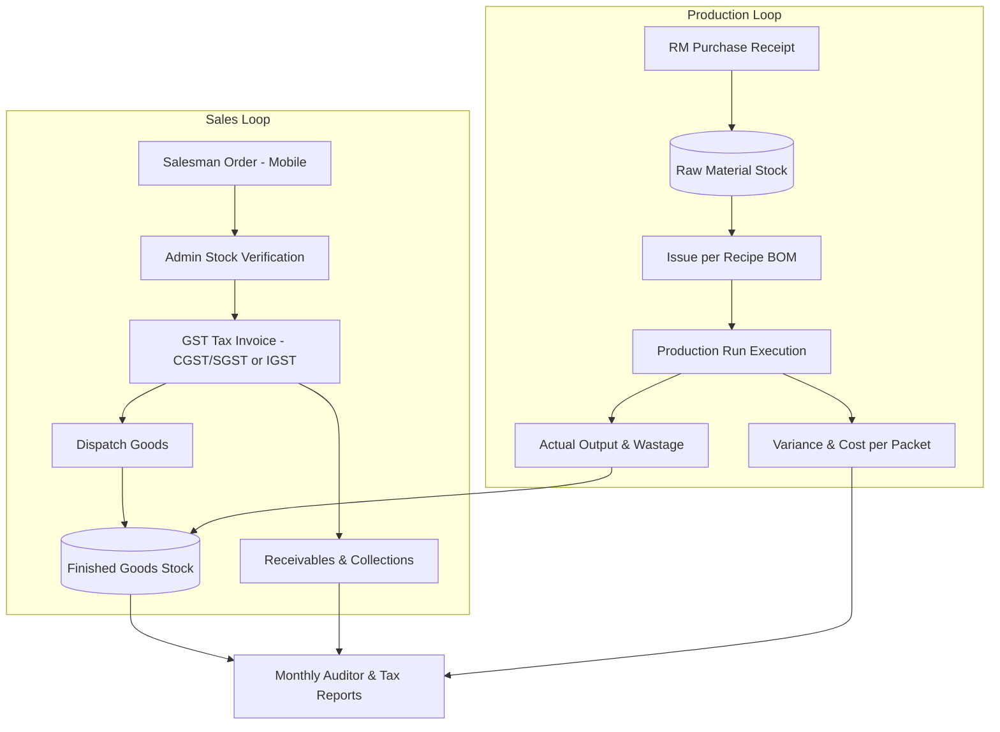
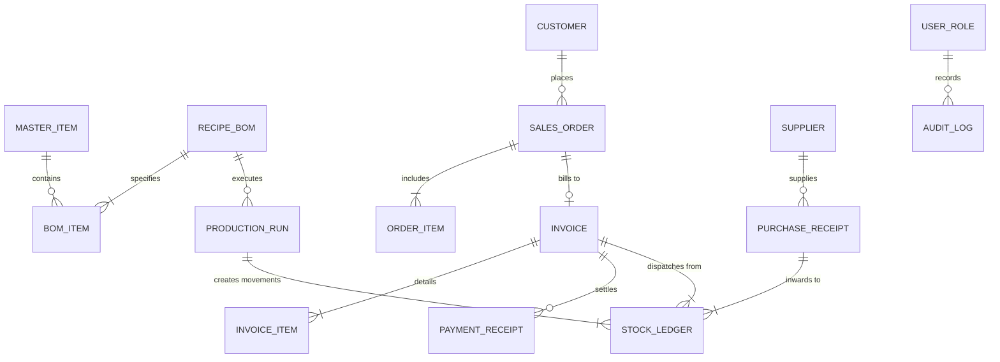

# Design Note: Order-to-Audit ERP for Small Food Manufacturer

**Centre for Digital Infrastructure, NIT Tiruchirappalli**  
**Applicant:** Individual Submission  
**Stack:** Pure JavaScript (Node.js runtime, zero-drift decimal/paisa arithmetic, embedded transactional web server)  

---

## 1. Executive Summary & Architecture

The system links two business loops through a single, reconciled stock ledger:
1. **Sales Loop:** Field Salesman Mobile Order → Factory Admin Verification → GST Tax Invoice (with FY numbering) → Dispatch (reducing Finished Goods stock) → Receivables & Collections.
2. **Production Loop:** Inward RM Purchase → Recipe-based BOM Issue → Daily Production Run → Finished Goods output (increasing Finished Goods stock) → Planned vs Actual Variance & Costing.

Accounting software such as Tally is not required for daily operations; an export to Tally-compatible XML is provided as an auditor export feature.

---

## 2. Relational Data Model & ER Diagram

Every balance change originates from a dedicated transaction entity with an immutable audit trail. Invoices are never deleted—cancellations post an offsetting credit note.

### Key Entities
- **`MasterItem`**: Code, name, unit, HSN, GST rate, standard rate, selling price, reorder level.
- **`RecipeBOM`**: Standard recipe for 200 packets of Murukku 200g (40kg flour, 10L oil, 1.2kg spice, 200 pouches, 10 cartons).
- **`StockLedgerEntry`**: Immutable transaction log: `[timestamp, itemId, movementType, qtyIn, qtyOut, balanceAfter, unitRate, totalVal, sourceDocId, refNumber, user]`.
- **`SalesOrder`**: Order header with real-time stock shortage detection.
- **`Invoice`**: GST tax invoice adhering to Indian tax laws (state code 33 for Tamil Nadu, 29 for Karnataka).
- **`PaymentReceipt`**: Collection entry updating balance due.

---

## 3. Stock Movement & Ledger Reconciliation

Stock balances are **never** stored as static, overwriteable numbers. Current stock is strictly derived by aggregating ledger entries:

$$\text{Current Stock} = \sum \text{Quantity In} - \sum \text{Quantity Out}$$

For every item:
$$\text{Opening Balance} + \text{Inward Receipts} - \text{Issues/Dispatches} \pm \text{Adjustments} = \text{Closing Balance}$$

### Movement Types
- `opening`: Initial audited starting stock
- `purchase`: Supplier inward receipts (increases RM stock)
- `issue_to_production`: Materials issued to floor (decreases RM stock)
- `production_output`: Good finished packets produced (increases FG stock)
- `packaging_used`: Pouches and cartons consumed (decreases packaging stock)
- `scrap_damage`: Heat-sealing scrap or wastage (decreases packaging stock)
- `dispatch`: Goods sent to customer against tax invoice (decreases FG stock)
- `return`: Invoice cancellation with credit note (restores FG stock)

---

## 4. Planned vs Actual Consumption & Variance Logic

When logging a production run, standard BOM consumption is compared against actual supervisor inputs:

$$\text{Variance \%} = \frac{\text{Actual} - \text{Standard}}{\text{Standard}} \times 100$$

A tolerance threshold of $\pm 3.0\%$ automatically flags abnormal deviations:
- **Yield Variance:** 188 actual packets vs 200 standard = $-6.0\%$ (FLAGGED: Yield Loss).
- **Oil Consumption:** 10.5 L actual vs 10.0 L standard = $+5.0\%$ (FLAGGED: Overconsumption).
- **Packaging Wastage:** 6 pouches damaged during heat sealing recorded explicitly.

---

## 5. Costing & Valuation Methodology

The system implements both **FIFO (First In First Out)** and **Weighted Average** valuation:

### Material Cost for Benchmark Run (188 packets):
- **Flour (40 kg):**
  - Under FIFO: 40 kg from opening balance @ ₹42.00 = **₹1,680.00**
  - Under Weighted Average: $\frac{(100 \times 42) + (60 \times 45)}{160} = ₹43.125/\text{kg} \implies 40 \times 43.125 =$ **₹1,725.00**
- **Cooking Oil (10.5 L):** $10.5 \times 140 =$ **₹1,470.00**
- **Salt & Spice Mix (1.2 kg):** $1.2 \times 200 =$ **₹240.00**
- **200g Pouches (194 consumed: 188 good + 6 damaged):** $194 \times 2.50 =$ **₹485.00**
- **Master Cartons (9 used):** $9 \times 15.00 =$ **₹135.00**

**Total Material & Packaging Cost:**
- FIFO: ₹4,010.00
- Weighted Average: ₹4,055.00

### Overheads Allocation:
- Direct Labour: ₹1,200.00
- Power & Fuel: ₹600.00
- Total Overheads: **₹1,800.00**

### Output Cost per Packet:
$$\text{Cost per Packet (FIFO)} = \frac{₹4,010 + ₹1,800}{188 \text{ packets}} = \mathbf{₹30.904} \approx \mathbf{₹30.90}$$
$$\text{Gross Margin (FIFO)} = ₹50.00 - ₹30.90 = \mathbf{₹19.10 \text{ (38.2\% margin)}}$$

$$\text{Cost per Packet (Weighted Avg)} = \frac{₹4,055 + ₹1,800}{188 \text{ packets}} = \mathbf{₹31.143} \approx \mathbf{₹31.14}$$
$$\text{Gross Margin (Weighted Avg)} = ₹50.00 - ₹31.14 = \mathbf{₹18.86 \text{ (37.7\% margin)}}$$

---

## 6. GST Tax Invoicing & Accounts Compliance

The factory is in Tamil Nadu (`State Code: 33`).
- **Intra-State Supplies (Retailer A in TN, State 33):**
  - Taxable Value: $150 \times ₹50 = ₹7,500.00$
  - CGST (2.5%): ₹187.50
  - SGST (2.5%): ₹187.50
  - Total Invoice: **₹7,875.00**
  - Post-payment (₹4,000 received): Outstanding balance = **₹3,875.00**
- **Inter-State Supplies (Distributor B in Karnataka, State 29):**
  - Stock check flags shortage: 120 ordered vs 88 available = **32 packets shortage**.
  - If billed, IGST applies at 5.0% ($120 \times 50 = ₹6,000 + ₹300 \text{ IGST} = ₹6,300$).

